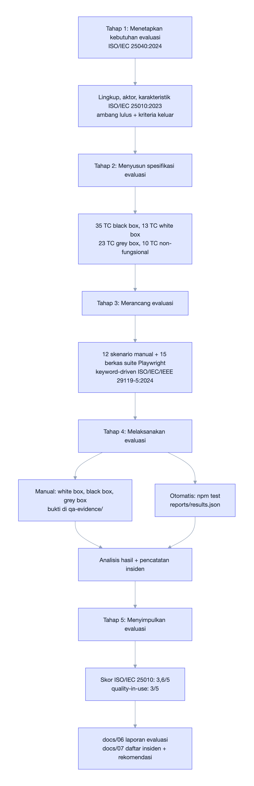
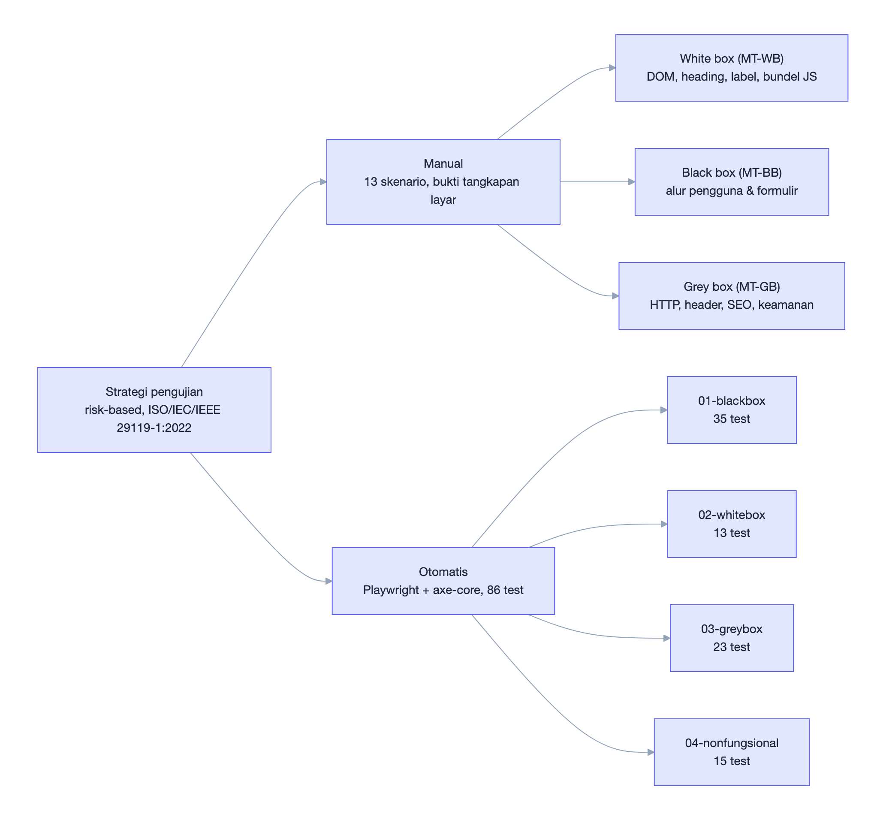
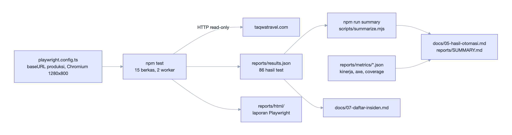
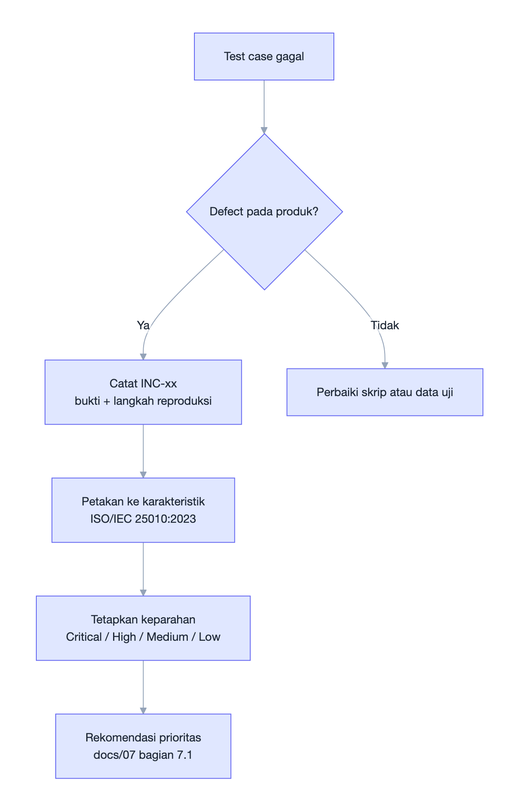

# Tugas Akhir QA - Pengujian taqwatravel.com

Repositori artefak **penjaminan kualitas (QA)** dan **pengujian perangkat lunak** untuk situs
produksi **[taqwatravel.com](https://taqwatravel.com)** (Taqwa Travel - travel haji & umroh
Palembang). Seluruh aktivitas disusun mengikuti standar internasional terbitan **2022–2026** dan
dijalankan secara **manual** (white box, black box, grey box) serta **otomatis**
(Playwright + axe-core).

| Ringkasan | Keterangan |
|---|---|
| Objek uji | [https://taqwatravel.com](https://taqwatravel.com) - produksi, pengujian *read-only* |
| Standar acuan | [8 standar ISO/IEC/IEEE 2022–2026](#standar-acuan) |
| Hasil terakhir | [86 test case: 71 lulus, 15 gagal](#hasil-pengujian) - kegagalan adalah defect nyata |
| Laporan | [Evaluasi kualitas](docs/06-laporan-evaluasi.md) · [Daftar insiden](docs/07-daftar-insiden.md) |
| Jadwal | [Timeline 12 Okt–5 Des 2026 + diagram Gantt](docs/08-timeline-dan-pembagian-tugas.md) |
| Wawancara | [Azhar Antasena Khadafi, QA Engineer](docs/09-wawancara-praktisi.md) - **rencana**, belum dilaksanakan; jawaban masih kosong |

## Kelompok 2

| # | Nama | GitHub |
|---|------|--------|
| 1 | Adji Komara Sandra | [@Adjisandra23](https://github.com/Adjisandra23) |
| 2 | Ilham Novriadi | [@ilhamnovriadi](https://github.com/ilhamnovriadi) |
| 3 | Nurul Azizah Lonek | [@NurulAzizahLonek26](https://github.com/NurulAzizahLonek26) |
| 4 | Reiksa Azra Octavian | [@reiksaazra16](https://github.com/reiksaazra16) |

Repositori ini disusun oleh Kelompok 2 untuk tugas akhir QA.

## Daftar Isi

- [Kelompok 2](#kelompok-2)
- [Objek Uji](#objek-uji)
- [Standar Acuan](#standar-acuan)
- [Alur Pengujian](#alur-pengujian)
- [Kategori Pengujian](#kategori-pengujian)
- [Alur Otomasi dan Pelaporan](#alur-otomasi-dan-pelaporan)
- [Alur Temuan Menjadi Insiden](#alur-temuan-menjadi-insiden)
- [Struktur Repositori](#struktur-repositori)
- [Menjalankan Pengujian](#menjalankan-pengujian)
- [Hasil Pengujian](#hasil-pengujian)
- [Bukti Pengujian Manual](#bukti-pengujian-manual)
- [Wawancara Praktisi](#wawancara-praktisi)
- [Literatur](#literatur)
- [Batasan](#batasan)

## Objek Uji

| Item | Keterangan |
|---|---|
| Objek uji (TOE) | [https://taqwatravel.com](https://taqwatravel.com) - Taqwa Travel (PT. Taqwa Cahaya Semesta) |
| Jenis sistem | Aplikasi web SvelteKit (SSR) di Cloudflare; API `api.taqwatravel.com`, aset `s3.taqwatravel.com` |
| Versi yang diuji | Deployment produksi per 26 November 2026 (eksekusi awal 20 November 2026) |
| Sifat pengujian | *Read-only*: tidak ada data pelanggan dibuat, tidak ada pembayaran/lead dikirim, formulir hanya diuji dengan input kosong atau tidak valid |
| Lingkup lengkap | [docs/02-test-plan.md §2.2](docs/02-test-plan.md#22-ruang-lingkup) |

## Standar Acuan

Delapan standar di bawah seluruhnya terbit pada **2022–2026**; standar di luar rentang tersebut
tidak dijadikan acuan. Salinan *preview* resmi, sitasi IEEE, dan tautan katalog tersedia di
**[literatur/README.md](literatur/README.md)**.

| # | Standar | Terbit | Peran dalam pengujian | Tautan |
|---|---------|--------|-----------------------|--------|
| 1 | ISO/IEC/IEEE **29119-1:2022** | 2022-01 | Konsep & proses pengujian, teknik desain tes | [Katalog](https://www.iso.org/standard/81291.html) · [Preview PDF](literatur/preview/ISO-IEC-IEEE-29119-1-2022_sample.pdf) |
| 2 | ISO/IEC/IEEE **29119-5:2024** | 2024-12 | Dasar otomasi *keyword-driven* | [Katalog](https://www.iso.org/standard/87233.html) · [Preview PDF](literatur/preview/ISO-IEC-IEEE-29119-5-2024_sample.pdf) |
| 3 | ISO/IEC **25010:2023** | 2023-11 | Model kualitas produk (9 karakteristik) | [Katalog](https://www.iso.org/standard/78176.html) · [Preview PDF](literatur/preview/ISO-IEC-25010-2023_sample.pdf) |
| 4 | ISO/IEC **25019:2023** | 2023-11 | Model kualitas dalam penggunaan | [Katalog](https://www.iso.org/standard/78177.html) · [Preview PDF](literatur/preview/ISO-IEC-25019-2023_sample.pdf) |
| 5 | ISO/IEC **25002:2024** | 2024-03 | Kerangka model kualitas | [Katalog](https://www.iso.org/standard/78175.html) · [Preview PDF](literatur/preview/ISO-IEC-25002-2024_sample.pdf) |
| 6 | ISO/IEC **25040:2024** | 2024-09 | Kerangka evaluasi kualitas (siklus 5 tahap) | [Katalog](https://www.iso.org/standard/83467.html) · [Preview PDF](literatur/preview/ISO-IEC-25040-2024_sample.pdf) |
| 7 | ISO/IEC **15408-1:2026** | 2026-05 | Kriteria evaluasi keamanan (menggantikan edisi 2022) | [Katalog](https://www.iso.org/standard/88134.html) · [Preview PDF](literatur/preview/ISO-IEC-15408-1-2026_sample.pdf) |
| 8 | ISO/IEC **18045:2026** | 2026-05 | Metodologi evaluasi keamanan (menggantikan edisi 2022) | [Katalog](https://www.iso.org/standard/88141.html) · [Preview PDF](literatur/preview/ISO-IEC-18045-2026_sample.pdf) |

Pemetaan lengkap standar ke setiap aktivitas ada di
[docs/01-standar-qa-2022-2026.md](docs/01-standar-qa-2022-2026.md).

## Alur Pengujian

Alur kerja mengikuti lima tahap **ISO/IEC 25040:2024**, dengan keluaran yang dapat ditelusuri pada
setiap tahap ([docs/02-test-plan.md §2.10](docs/02-test-plan.md#210-fase-kerja-isoiec-250402024)).

*Gambar 1 - Alur pengujian lima tahap ISO/IEC 25040:2024 beserta keluarannya. Sumber Mermaid:
[diagrams/01-alur-pengujian.mmd](diagrams/01-alur-pengujian.mmd).*

## Kategori Pengujian

Pengujian manual mencakup tiga kategori wajib (white box, black box, grey box); pengujian otomatis
dibagi menjadi empat suite. Rancangan teknik dan test case-nya ada di
[docs/03-test-design.md](docs/03-test-design.md).

*Gambar 2 - Pembagian pengujian manual (WB, BB, GB) dan otomatis (4 suite, 86 test). Sumber
Mermaid: [diagrams/02-kategori-pengujian.mmd](diagrams/02-kategori-pengujian.mmd).*

## Alur Otomasi dan Pelaporan

*Gambar 3 - Alur eksekusi otomasi hingga laporan dan rekap metrik. Sumber Mermaid:
[diagrams/03-alur-otomasi-pelaporan.mmd](diagrams/03-alur-otomasi-pelaporan.mmd).*

## Alur Temuan Menjadi Insiden

Setiap test case yang gagal diperiksa apakah penyebabnya defect produk atau kesalahan skrip. Hanya
defect produk yang dicatat sebagai insiden dan dipetakan ke karakteristik kualitas
([docs/07-daftar-insiden.md](docs/07-daftar-insiden.md)).

*Gambar 4 - Triase kegagalan test menjadi insiden INC-xx beserta keparahan dan rekomendasi. Sumber
Mermaid: [diagrams/04-alur-temuan-insiden.mmd](diagrams/04-alur-temuan-insiden.mmd).*

> Seluruh diagram disimpan sebagai **gambar PNG** di [diagrams/](diagrams) agar bisa langsung
> dipakai di laporan cetak maupun presentasi. Berkas sumber Mermaid (`*.mmd`) berada di folder yang
> sama; regenerasi dengan `npm run diagrams` (memakai Chromium Playwright yang sudah terpasang dan
> mengambil pustaka Mermaid dari CDN, jadi perlu koneksi internet).

## Struktur Repositori

| Path | Isi |
|---|---|
| [docs/01-standar-qa-2022-2026.md](docs/01-standar-qa-2022-2026.md) | Studi dokumentasi 8 standar + pemetaan ke aktivitas |
| [docs/02-test-plan.md](docs/02-test-plan.md) | Rencana pengujian: lingkup, metrik, ambang, risiko |
| [docs/03-test-design.md](docs/03-test-design.md) | Teknik desain, test case, matriks keterlacakan |
| [docs/04-hasil-manual.md](docs/04-hasil-manual.md) | Hasil eksekusi manual: white box, black box, grey box |
| [docs/05-hasil-otomasi.md](docs/05-hasil-otomasi.md) | Hasil otomatis (dihasilkan [scripts/summarize.mjs](scripts/summarize.mjs)) |
| [docs/06-laporan-evaluasi.md](docs/06-laporan-evaluasi.md) | Laporan evaluasi kualitas ISO/IEC 25010 & 25019 |
| [docs/07-daftar-insiden.md](docs/07-daftar-insiden.md) | 18 insiden + tingkat keparahan + rekomendasi |
| [docs/08-timeline-dan-pembagian-tugas.md](docs/08-timeline-dan-pembagian-tugas.md) | Timeline 12 Okt–5 Des 2026, pembagian tugas 4 anggota, gambar Gantt |
| [docs/09-wawancara-praktisi.md](docs/09-wawancara-praktisi.md) | Rencana wawancara praktisi QA: profil narasumber dan 4 pertanyaan (jawaban belum diisi) |
| [diagrams/](diagrams) | 6 gambar PNG diagram + sumber Mermaid `*.mmd` ([Gambar 1–4](#alur-pengujian), [Gantt](diagrams/05-timeline-gantt.png), [timeline](diagrams/06-timeline-milestone.png)) |
| [tests/](tests) | Suite otomasi: [01-blackbox](tests/01-blackbox) · [02-whitebox](tests/02-whitebox) · [03-greybox](tests/03-greybox) · [04-nonfungsional](tests/04-nonfungsional) · [support/helpers.ts](tests/support/helpers.ts) |
| [scripts/](scripts) | [summarize.mjs](scripts/summarize.mjs) (regenerasi docs/05) · [capture-manual-evidence.mjs](scripts/capture-manual-evidence.mjs) (tangkapan bukti) · [render-diagrams.mjs](scripts/render-diagrams.mjs) (Mermaid → PNG) |
| [qa-evidence/](qa-evidence) | 9 tangkapan layar pengujian manual + [measurements.json](qa-evidence/measurements.json) |
| [literatur/](literatur) | [Indeks & sitasi](literatur/README.md) + 8 PDF *preview* resmi di [literatur/preview/](literatur/preview) |
| [reports/](reports) | [results.json](reports/results.json) · [SUMMARY.md](reports/SUMMARY.md) · [metrics/](reports/metrics) |
| [playwright.config.ts](playwright.config.ts) | Konfigurasi Playwright (baseURL, viewport, worker) |
| [package.json](package.json) | Dependensi dan skrip npm |

Folder `reports/html/`, `reports/artifacts/`, `test-results/`, `playwright-report/`, dan
`node_modules/` bersifat *generated* sehingga tidak ikut di-commit (lihat
[.gitignore](.gitignore)). Yang di-commit sebagai bukti adalah [qa-evidence/](qa-evidence),
[reports/results.json](reports/results.json), [reports/SUMMARY.md](reports/SUMMARY.md), dan
[reports/metrics/](reports/metrics).

## Menjalankan Pengujian

| Perintah | Fungsi |
|---|---|
| `npm install` | Memasang dependensi dari [package.json](package.json) |
| `npx playwright install chromium` | Mengunduh Chromium (sekali saja) |
| `npm test` | Menjalankan seluruh 86 test case (± 2 menit) sesuai [playwright.config.ts](playwright.config.ts) |
| `npm run test:blackbox` | Hanya suite [01-blackbox](tests/01-blackbox) |
| `npm run test:whitebox` | Hanya suite [02-whitebox](tests/02-whitebox) |
| `npm run test:greybox` | Hanya suite [03-greybox](tests/03-greybox) |
| `npm run test:nonfungsional` | Hanya suite [04-nonfungsional](tests/04-nonfungsional) |
| `npm run summary` | Meregenerasi [docs/05-hasil-otomasi.md](docs/05-hasil-otomasi.md) dan [reports/SUMMARY.md](reports/SUMMARY.md) |
| `npm run diagrams` | Merender ulang seluruh `diagrams/*.mmd` menjadi PNG ([diagrams/](diagrams)) |
| `npm run report` | Membuka laporan HTML Playwright dari `reports/html/` |

## Hasil Pengujian

| Metrik | Nilai |
|---|---|
| Total test case otomatis | **86** |
| Lulus | **71** |
| Gagal | **15** |
| Tingkat kelulusan | **82,6%** |
| Durasi eksekusi | 163,7 detik |
| Tanggal eksekusi | 26 November 2026 |

Lima belas kegagalan tersebut **sengaja dipertahankan** karena merupakan defect nyata pada situs
yang diuji, bukan akibat skrip yang rusak; karena itu `npm test` berakhir dengan exit code 1.
Rincian per test case ada di [docs/05-hasil-otomasi.md](docs/05-hasil-otomasi.md), data mentah di
[reports/results.json](reports/results.json), dan pemetaan ke insiden di
[docs/07-daftar-insiden.md](docs/07-daftar-insiden.md). Temuan utamanya: harga tidak tampil di
halaman paket, dua tautan internal 404, header keamanan tidak lengkap, HTTP tidak dialihkan ke
HTTPS, serta pelanggaran aksesibilitas (`button-name`, `color-contrast`).

## Bukti Pengujian Manual

| Kode | Skenario | Berkas bukti |
|---|---|---|
| MT-BB-01 | Beranda desktop | [beranda-desktop-1280x800.png](qa-evidence/MT-BB-01/beranda-desktop-1280x800.png) |
| MT-BB-02 | Beranda & menu mobile | [beranda-mobile-390x844.png](qa-evidence/MT-BB-02/beranda-mobile-390x844.png) · [menu-mobile-terbuka-390x844.png](qa-evidence/MT-BB-02/menu-mobile-terbuka-390x844.png) |
| MT-BB-03 | Dropdown kategori | [dropdown-kategori-terbuka-1280x800.png](qa-evidence/MT-BB-03/dropdown-kategori-terbuka-1280x800.png) |
| MT-BB-04 | Cek reservasi kode tidak valid | [cek-reservasi-kode-tidak-valid-1280x800.png](qa-evidence/MT-BB-04/cek-reservasi-kode-tidak-valid-1280x800.png) |
| MT-BB-05 | Halaman 404 | [halaman-404.png](qa-evidence/MT-BB-05/halaman-404.png) |
| MT-BB-06 | Formulir agen submit kosong | [form-agen-submit-kosong-1280x800.png](qa-evidence/MT-BB-06/form-agen-submit-kosong-1280x800.png) |
| MT-BB-07 | Daftar paket tanpa harga | [daftar-paket-tanpa-harga-1280x800.png](qa-evidence/MT-BB-07/daftar-paket-tanpa-harga-1280x800.png) |
| MT-GB-02 | Dashboard login admin | [dashboard-login-admin-1280x800.png](qa-evidence/MT-GB-02/dashboard-login-admin-1280x800.png) |

Hasil lengkap tiap skenario manual (termasuk yang tidak disertai tangkapan layar) ada di
[docs/04-hasil-manual.md](docs/04-hasil-manual.md).

## Wawancara Praktisi

Wawancara praktisi QA **masih direncanakan dan belum dilaksanakan**, sehingga hasil pengujian pada
repositori ini belum dibandingkan dengan pengalaman industri. Narasumber yang dituju adalah
**Azhar Antasena Khadafi**, QA Engineer di IDEKU dengan pengalaman ± 5 tahun (Tokopedia 2021-2023,
PHINCON 2023-2024, IDEKU 2024-sekarang); data profilnya bersumber dari profil LinkedIn publik, bukan
hasil wawancara. Daftar pertanyaan, ruang jawaban yang masih kosong, dan catatan etikanya ada di
[docs/09-wawancara-praktisi.md](docs/09-wawancara-praktisi.md).

| Pertanyaan | Cakupan pertanyaan (belum dijawab) |
|---|---|
| Profil tester | Latar belakang pendidikan dan perjalanan karier; perbedaan peran di Tokopedia, PHINCON, dan IDEKU; alat dan ritme kerja sehari-hari |
| Kondisi testing saat ini | Kondisi pengujian di lapangan; pembagian kerja manual vs otomasi; siapa yang menentukan keputusan *go/no-go* rilis |
| Prospek karier | Menjanjikan atau tidak; jenjang karier QA yang terlihat di lapangan; saran untuk mahasiswa yang ingin masuk QA |
| Kendala lapangan | Kendala yang dialami dan cara menyiasatinya; sikap saat akses sistem tidak diberikan atau ada tekanan meloloskan rilis |

Karena jawaban belum tersedia, tidak ada kutipan narasumber yang dipakai di dokumen lain. Kaitan pertanyaan
dengan temuan repositori (INC-07/08, INC-13/14/16, dan batas panel admin pada
[docs/07 §7.2](docs/07-daftar-insiden.md#72-insiden-yang-tidak-dapat-diuji-blocked)) baru diisi pada
[docs/09 §9.5](docs/09-wawancara-praktisi.md) setelah wawancara dilakukan.

## Literatur

Seluruh acuan adalah **standar internasional**, bukan artikel jurnal. Folder
[literatur/preview/](literatur/preview) memuat *sample document* resmi dari penerbit (10-15
halaman pertama) untuk keperluan identifikasi; **teks lengkap standar berbayar tidak
didistribusikan ulang**. Sitasi IEEE, tautan katalog, dan cara memperoleh teks penuh tersedia di
[literatur/README.md](literatur/README.md).

## Batasan

- Panel admin setelah login tidak diuji karena tidak ada kredensial uji; fokus hanya pada kontrol
  akses dan `noindex` ([docs/07 §7.2](docs/07-daftar-insiden.md#72-insiden-yang-tidak-dapat-diuji-blocked)).
- Uji beban/stress, uji penetrasi, dan pengiriman formulir dengan data valid tidak dijalankan karena
  memerlukan izin tertulis pemilik sistem ([docs/02 §2.2](docs/02-test-plan.md#22-ruang-lingkup)).
- Metrik kinerja bergantung pada jaringan publik saat eksekusi dan dapat berbeda antar eksekusi
  ([reports/metrics/](reports/metrics)).
- Preview standar tidak memuat seluruh klausul, sehingga pemetaan fase diverifikasi dari struktur
  resmi standar ([literatur/README.md §5](literatur/README.md#5-keterbatasan)).
