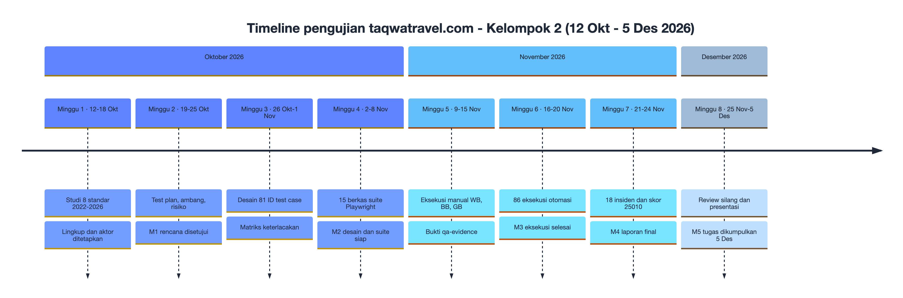
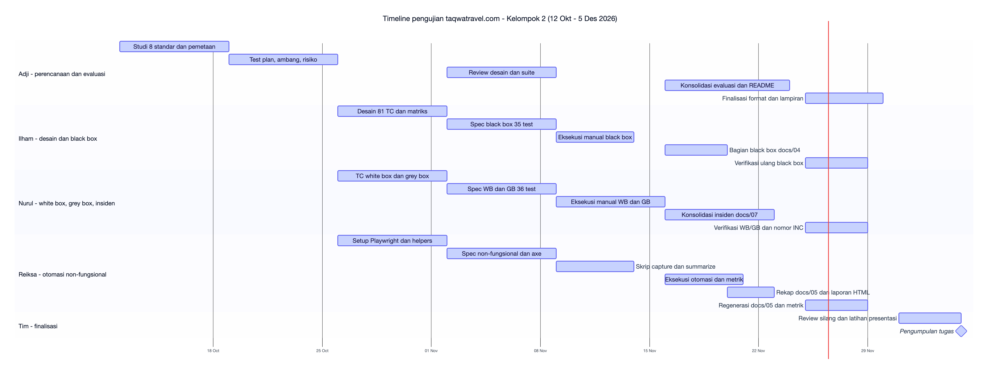

# 08 — Timeline Pengujian & Pembagian Tugas (Kelompok 2)

Dokumen ini menjadwalkan seluruh aktivitas pengujian pada tugas akhir ini dan membagi beban
kerjanya secara merata ke empat anggota **Kelompok 2**. Ruang lingkup mengacu pada
[docs/02 §2.2](02-test-plan.md#22-ruang-lingkup), tahapan mengikuti **ISO/IEC 25040:2024**, dan
keluaran mengikuti [docs/03](03-test-design.md).

> **Asumsi jadwal.** Proyek berdurasi **8 minggu, 12 Oktober – 5 Desember 2026**, dengan eksekusi
> otomasi pada **20 November 2026**, diverifikasi ulang **26 November 2026** (lihat
> [docs/05](05-hasil-otomasi.md)) dan **batas pengumpulan
> tugas 5 Desember 2026**. Bila dosen menetapkan tanggal lain, seluruh minggu dapat digeser tanpa
> mengubah urutan ketergantungan.

## 8.1 Timeline mingguan

| Minggu | Tanggal | Fase ISO/IEC 25040:2024 | Aktivitas utama | PIC | Keluaran |
|---|---|---|---|---|---|
| 1 | 12–18 Okt 2026 | Menetapkan kebutuhan evaluasi | Studi 8 standar 2022–2026, identifikasi objek uji, aktor, dan ruang lingkup | Adji | [docs/01](01-standar-qa-2022-2026.md) |
| 2 | 19–25 Okt 2026 | Menetapkan kebutuhan evaluasi | Test plan: metrik & ambang 25010, kriteria masuk/keluar, risiko | Adji, review Ilham | [docs/02](02-test-plan.md) |
| 3 | 26 Okt–1 Nov 2026 | Menyusun spesifikasi evaluasi | Desain 81 ID test case (35 BB, 13 WB, 23 GB, 10 NF), data uji, matriks keterlacakan, 13 skenario manual | Ilham, Nurul | [docs/03](03-test-design.md) |
| 4 | 2–8 Nov 2026 | Merancang evaluasi | Implementasi 15 berkas suite Playwright, helpers, konfigurasi lingkungan | Ilham, Nurul, Reiksa | [tests/](../tests), [playwright.config.ts](../playwright.config.ts) |
| 5 | 9–15 Nov 2026 | Melaksanakan evaluasi | Eksekusi manual white box, black box, grey box + tangkapan bukti | Ilham, Nurul | [docs/04](04-hasil-manual.md), [qa-evidence/](../qa-evidence) |
| 6 | 16–20 Nov 2026 | Melaksanakan evaluasi | Eksekusi otomasi 86 test case, metrik kinerja/axe/coverage, laporan HTML | Reiksa | [docs/05](05-hasil-otomasi.md), [reports/](../reports) |
| 6 | 16–22 Nov 2026 | Melaksanakan evaluasi | Konsolidasi temuan menjadi 18 insiden + keparahan + rekomendasi | Nurul, dibantu semua | [docs/07](07-daftar-insiden.md) |
| 7 | 21–24 Nov 2026 | Menyimpulkan evaluasi | Skor 25010/25019, laporan evaluasi, README | Adji, semua | [docs/06](06-laporan-evaluasi.md), [README](../README.md) |
| 8 | 25 Nov–5 Des 2026 | Menyimpulkan evaluasi & finalisasi | Review akhir dokumen, verifikasi ulang temuan, latihan presentasi, pengumpulan tugas | Semua, koordinasi Adji | Paket tugas final (dikumpulkan 5 Des) |

Ringkasan jadwal dalam bentuk gambar — delapan minggu pengerjaan dan lima milestone:

*Gambar 8.1 — Timeline mingguan 12 Oktober – 5 Desember 2026 beserta milestone M1–M5. Sumber
Mermaid: [diagrams/06-timeline-milestone.mmd](../diagrams/06-timeline-milestone.mmd).*

## 8.2 Pembagian tugas per anggota

| Anggota | Peran | Tugas utama | Keluaran | Beban |
|---|---|---|---|---|
| **Adji Komara Sandra** | Koordinator & dokumentasi perencanaan | Studi 8 standar + pemetaan fase 25040; menyusun test plan, ambang, dan risiko; konsolidasi skor 25010/25019; review silang seluruh dokumen; README | [docs/01](01-standar-qa-2022-2026.md), [docs/02](02-test-plan.md), [docs/06](06-laporan-evaluasi.md), [README](../README.md) | 25 jam (25%) |
| **Ilham Novriadi** | Desain tes & black box | Menyusun 81 ID test case + matriks keterlacakan; 7 berkas spec black box (35 test); 7 skenario manual black box + bukti; bagian black box pada hasil manual | [docs/03](03-test-design.md), [tests/01-blackbox](../tests/01-blackbox), [docs/04](04-hasil-manual.md), [qa-evidence/](../qa-evidence) | 25 jam (25%) |
| **Nurul Azizah Lonek** | White box, grey box & insiden | 13 TC white box + 23 TC grey box; 5 berkas spec (2 WB + 3 GB); eksekusi manual WB/GB + bukti; konsolidasi 18 insiden dan rekomendasi | [tests/02-whitebox](../tests/02-whitebox), [tests/03-greybox](../tests/03-greybox), [docs/04](04-hasil-manual.md), [docs/07](07-daftar-insiden.md) | 25 jam (25%) |
| **Reiksa Azra Octavian** | Otomasi non-fungsional & infrastruktur | 10 TC non-fungsional; 3 berkas spec NF (kinerja, responsif, axe); konfigurasi Playwright, helpers, skrip bukti & rekap; metrik; laporan otomasi | [tests/04-nonfungsional](../tests/04-nonfungsional), [playwright.config.ts](../playwright.config.ts), [scripts/](../scripts), [docs/05](05-hasil-otomasi.md), [reports/metrics/](../reports/metrics) | 25 jam (25%) |

Pemerataan beban: **4 × 25 = 100 jam** (21 jam pengerjaan inti + 4 jam finalisasi). Setiap anggota
memegang satu area pertanggungjawaban utama dan tetap mengeksekusi sebagian test case, sehingga
tidak ada anggota yang hanya menyusun dokumen atau hanya menulis kode.

Tahap finalisasi (25 November – 5 Desember 2026) menambah **4 jam** per anggota:

| Anggota | Tugas finalisasi |
|---|---|
| Adji | Pemeriksaan format, sitasi, lampiran, dan koordinasi pengumpulan |
| Ilham | Verifikasi ulang temuan black box beserta buktinya |
| Nurul | Verifikasi white/grey box dan sinkronisasi nomor INC |
| Reiksa | Regenerasi docs/05 dan metrik bila skrip berubah, arsip laporan HTML |

## 8.3 Diagram Gantt

*Gambar 8.2 — Diagram Gantt 12 Oktober – 5 Desember 2026: beban tiap anggota, tahap finalisasi,
dan milestone pengumpulan 5 Desember. Sumber Mermaid:
[diagrams/05-timeline-gantt.mmd](../diagrams/05-timeline-gantt.mmd).*

## 8.4 Ketentuan tugas dosen dan penanggung jawab

| Ketentuan tugas | Penanggung jawab | Bukti |
|---|---|---|
| Kajian standar terbitan 2022–2026 | Adji | [docs/01](01-standar-qa-2022-2026.md) |
| Rencana dan desain pengujian | Adji, Ilham | [docs/02](02-test-plan.md), [docs/03](03-test-design.md) |
| White box (manual + otomatis) | Nurul | TC-WB-01…13, [tests/02-whitebox](../tests/02-whitebox) |
| Black box (manual + otomatis) | Ilham | TC-BB-01…35, [tests/01-blackbox](../tests/01-blackbox) |
| Grey box (manual + otomatis) | Nurul | TC-GB-01…23, [tests/03-greybox](../tests/03-greybox) |
| Pengujian otomatis (seluruh suite) | Reiksa | [tests/](../tests), [playwright.config.ts](../playwright.config.ts) |
| Non-fungsional: kinerja, responsif, aksesibilitas | Reiksa | TC-NF-01…10, [reports/metrics/](../reports/metrics) |
| Laporan evaluasi dan daftar insiden | Adji (06), Nurul (07) | [docs/06](06-laporan-evaluasi.md), [docs/07](07-daftar-insiden.md) |

## 8.5 Milestone

| Milestone | Tanggal | Kriteria selesai |
|---|---|---|
| M1 — Rencana disetujui | 25 Okt 2026 | [docs/02](02-test-plan.md) final: ambang, risiko, kriteria keluar |
| M2 — Desain dan suite siap | 8 Nov 2026 | 81 ID test case + 15 berkas spec dapat dijalankan |
| M3 — Eksekusi selesai | 20 Nov 2026 | 86 eksekusi otomasi + 13 skenario manual, bukti lengkap (verifikasi ulang 26 Nov 2026) |
| M4 — Laporan final | 24 Nov 2026 | [docs/06](06-laporan-evaluasi.md) dan [docs/07](07-daftar-insiden.md) final, README siap |
| M5 — Tugas dikumpulkan | 5 Des 2026 | Seluruh dokumen 01–08, bukti, dan literatur diperiksa; presentasi siap |

## 8.6 Ketergantungan dan jalur kritis

1. **Jalur kritis:** docs/02 → docs/03 → suite otomasi → eksekusi 20 Nov → docs/07 → docs/06.
   Keterlambatan pada salah satu tahap menggeser seluruh tahap berikutnya.
2. **Buffer:** 21 November – 4 Desember 2026 disediakan untuk mengulang eksekusi otomasi,
   meregenerasi [docs/05](05-hasil-otomasi.md), dan merevisi laporan sebelum pengumpulan
   5 Desember 2026.
3. **Ketergantungan eksternal:** akses situs produksi dan izin pemilik sistem (lihat
   [docs/02 §2.9](02-test-plan.md#29-risiko-pengujian)); tanpa akses, milestone M3 tidak dapat
   dicapai.
